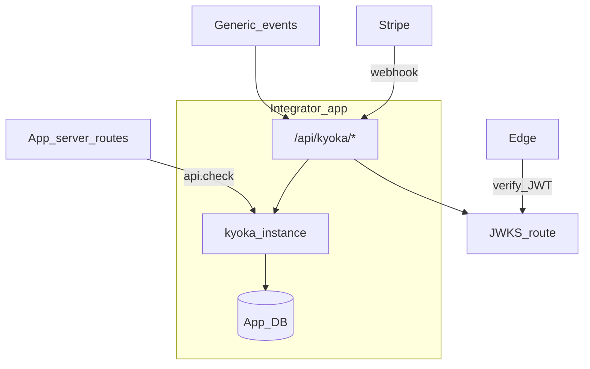

# Kyoka — architecture

## Shape

Better Auth–style TypeScript library:

1. `kyoka({ database, planStore, plans, plugins, … })` creates an instance
2. Mount `instance.handler` on `/api/kyoka/*` (configurable base path)
3. Server code calls `instance.api.check` / admin methods in-process
4. Optional remote clients use HTTP + `baseURL` (hosted or another mount) — same protocol for every language in MVP; no dedicated Node cloud client package yet (see [DECISIONS.md](./DECISIONS.md))

## Packages (this repo)

| Package | Role |
|---|---|
| `@kyoka-js/kyoka` | Core: check, tokens, events, state machine, admin, mounts |
| `@kyoka-js/stripe` | Stripe webhook adapter plugin |
| Adapters | **`pg` first** (direct SQL); Prisma / Drizzle / sqlite later as optional adapters |
| CLI | Generate / migrate schema |

Workspace tooling: **Bun**. Kyoka does not require the host app’s ORM — same Postgres, Kyoka-owned `kyoka_*` tables.

Private `kyoka-cloud` consumes these via npm; does not fork core.

## Trust boundaries

| Zone | Role |
|---|---|
| Browser / device | Untrusted for enforcement; UI booleans only |
| App server / BFF / edge you deploy | Trusted verifiers |
| Kyoka private key | Server-only; mint JWTs |
| JWKS | Public; verify only |

Privileged actions (PDF bytes, etc.) must enforce on a trusted server via live `check` or verified JWT.

## Cookie KISS (integrator pattern)

- After `check`, set entitlement JWT: `HttpOnly; Secure; SameSite=Lax`
- Pass soft booleans/limits to UI via loader / `/me/features`
- Auth session cookie (Clerk, etc.) proves **who**; Kyoka JWT proves **may they** for a feature
- Matching cookies for the request URL are sent together; server reads what it needs

## Check pipeline

1. Resolve subject (alias or `sub_…`); lazy-create with `defaultPlan` if missing
2. Load overrides + plan features (`config` XOR `database`)
3. Apply state machine (entitled statuses)
4. Compare `used` to `limit` when provided
5. Return JSON + signed JWT (allow or deny)

## Ingress pipeline

1. Generic event or plugin webhook
2. Verify auth (API key / same-app) or provider signature
3. Idempotency lookup
4. Normalize → `applyBillingEvent`
5. Link aliases; update plan/status timestamps

## planStore

- `config`: read `plans` from options every check
- `database`: read `kyoka_plan`; if none → error

## Related

- [DOMAIN.md](./DOMAIN.md), [SCHEMA.md](./SCHEMA.md), [STATE_MACHINE.md](./STATE_MACHINE.md)
- [API_CONTRACT.md](./API_CONTRACT.md), [PLUGINS.md](./PLUGINS.md)
