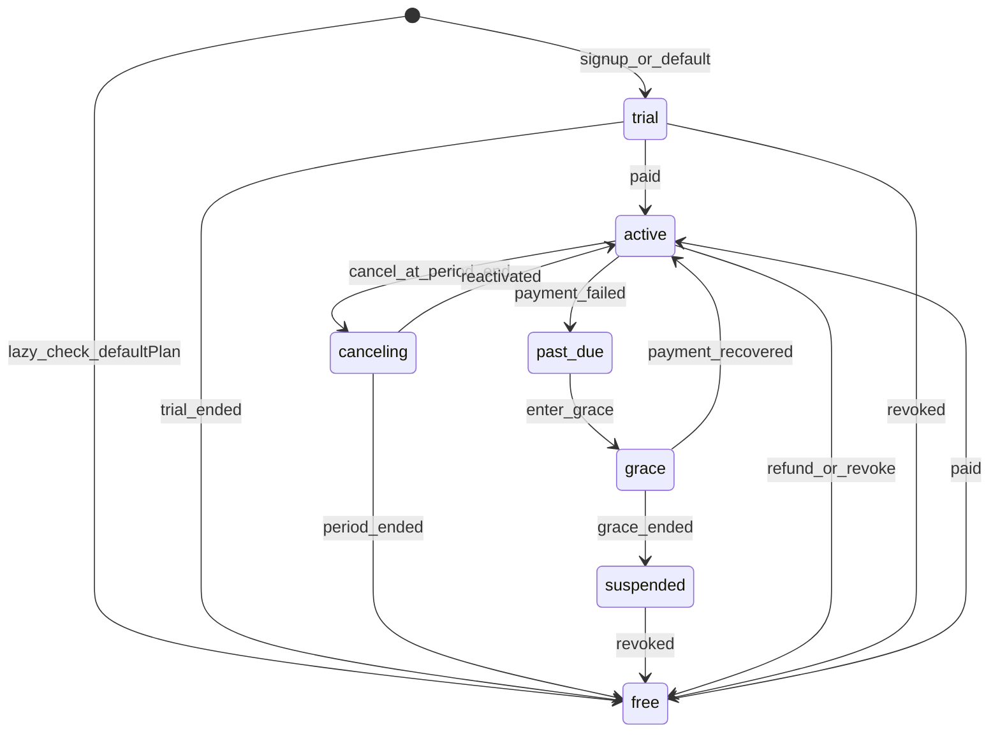

# Kyoka — billing state machine

Money events change capability. App code should not reimplement this per feature.

## States

| State | Entitled? | Notes |
|---|---|---|
| `trial` | Yes (per plan rules) | Capabilities from trial plan; branding may still show via separate feature key |
| `active` | Yes | Paid |
| `canceling` | Yes until `periodEndsAt` | Cancel at period end |
| `past_due` | Transition | Payment failed; usually moves to `grace` |
| `grace` | Yes until `graceEndsAt` | Do not yank features at 00:01 |
| `suspended` | No | Grace ended / hard fail |
| `free` | Per free plan only | Default after signup or revoke |

Exact naming in code may use these string enums. Map provider events onto them in plugins.

## Transitions

## Entitlement evaluation vs state

`check` uses:

1. Subject override (if any) — still respects “suspended/free with no feature” unless override explicitly enables
2. Plan feature map for current plan slug
3. Whether status is in an **entitled** set (`trial`, `active`, `canceling`, `grace`) for paid features

Policy detail for MVP implementers:

- `free` / `suspended`: only features on the free plan (or overrides)
- `canceling`: paid plan features until `periodEndsAt`
- `grace`: paid plan features until `graceEndsAt`
- Token `exp` is a snapshot TTL (default 1h), not a replacement for period/grace timestamps

## Provider mapping (Stripe plugin intent)

| Stripe-ish event | Toward |
|---|---|
| subscription created/active | `active` + plan from price map |
| `cancel_at_period_end` | `canceling` + `periodEndsAt` |
| payment failed | `past_due` → `grace` (config grace days) |
| subscription deleted / revoked | `free` |
| period ended while canceling | `free` |

Exact Stripe event names live in `@kyoka/stripe`; core only sees normalized status.

## Idempotency

Every ingress event carries an idempotency key (Stripe `event.id` or client key). Replays no-op after first apply.
