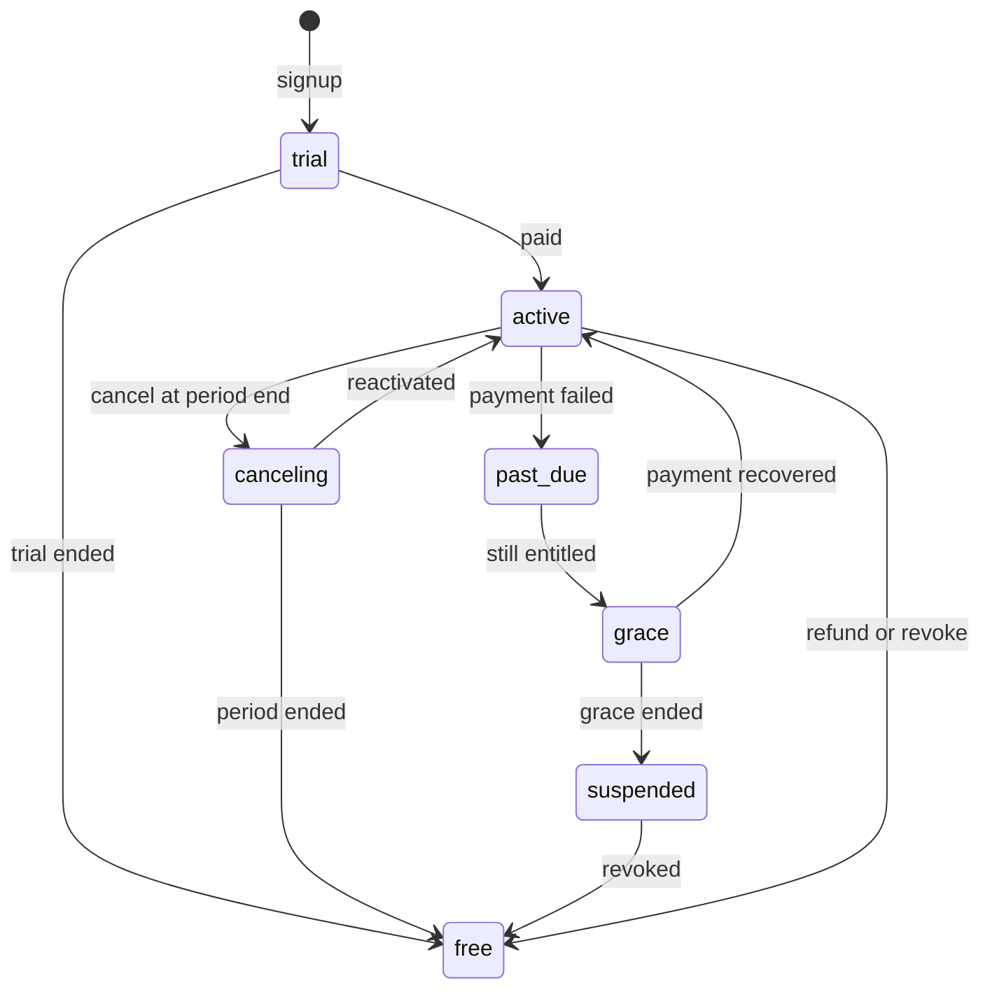
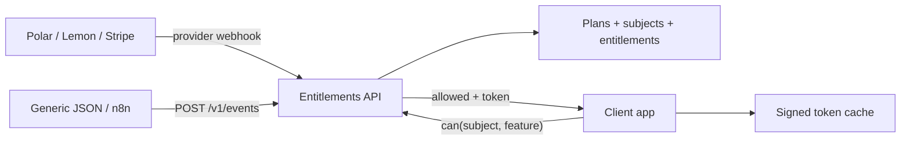

# License + Entitlements API — product brief

Handoff document for a **new, separate product**. Copy this file into the new workspace. It is not an EzyForm feature and should not be merged into EzyForm’s `PRODUCT.md` / `PLAN.md`.

Written 2026-11-12 from the design conversation. EzyForm lives at `/home/cs/proj/Potro` (this repo). Integration with EzyForm is **later**, when EzyForm gets automation (outbound webhooks / n8n-class). Until then this product stands alone.

---

## One-liner

A tiny API whose job is answering `can(subject, feature)` with a plain JSON answer **and** a **signed token** the client can cache. Payments are optional input via webhooks. You are not a merchant of record.

Stripe / Polar / Lemon take the money. This product is the **decision layer after money**: plans, feature keys, seats, trials, grace periods.

---

## Locked decisions

| Topic | Decision |
|---|---|
| Company shape | **Separate product / service**, not an EzyForm feature, not an internal-only module forever. |
| EzyForm | Customer later, when EzyForm adds automation. Not day-one dogfood unless convenient. |
| Payments | **Do not take payment yourself** as the default. Clients bill on Polar / Lemon Squeezy / Stripe (or anything). Webhooks are **user/entitlement ingress**. |
| First-party checkout | Optional later add-on. Not MVP. Competing with Polar/Lemon on tax/refunds is out of scope. |
| Ingress primitive | **Generic JSON webhook/event** is the core. Named adapters (Polar, Lemon, Stripe) map onto that same event. |
| Product surface | `can()` + signed token. Not a billing portal, not LaunchDarkly, not Keygen-complete. |
| Versioning | Public API is `/v1/` from day one even if v2 does not exist. |
| Docs | A stranger must finish integration from the README in ~10 minutes. This is the moat. |

---

## The problem

Every SaaS ends up with:

1. Stripe/Polar/Lemon checkout
2. A webhook that sets `user.plan = "pro"`
3. `if (user.plan === "pro")` in dozens of files
4. Then trials, cancel-at-period-end, failed cards, grace, seats, quotas

That pile is the product. Extract it. Document it. Sign the answer.

WHMCS already thinks this way (products, invoices, suspend/unsuspend, license keys, hooks on billing state). Next.js people want that **model** without running WHMCS.

---

## What this is / is not

**This is**

- Entitlements / licensing decision API
- Payment-agnostic (webhook in, `can()` out)
- Signed, cacheable answers
- A billing **state machine** (trial, active, canceling, past_due, grace, revoked)

**This is not**

- A form builder feature
- A merchant of record (Polar/Lemon/Stripe already do that)
- Feature flags / percentage rollouts (LaunchDarkly)
- Full software licensing (machine activation, floating seats, Keygen’s whole surface)
- EzyForm’s Polar checkout replacement

| Layer | Who | Job |
|---|---|---|
| Take money, tax, invoices | Polar / Stripe / Lemon | Checkout, VAT, subscriptions |
| License keys, devices, offline binaries | Keygen | “This machine may run this binary” |
| Feature decision | **this API** | `can(subject, feature)` + signed token |

Keygen, Stripe Entitlements, Polar Benefits, Chargebee exist. This wins only by being **smaller and clearer**, with docs a stranger can paste.

---

## Domain model

Three records (names can change; the split should not):

1. **Your customer** — the company that embeds the API (a future EzyForm, or any SaaS). They hold an API key.
2. **Subject** — whoever *their* app will ask about: `user_abc`, `org_9`, or `license_key_…`. Not necessarily a Clerk user on *this* product.
3. **Entitlements on that subject** — feature keys from the purchased plan, plus expiry / seats / grace.

Four objects the API talks about:

| Object | Meaning |
|---|---|
| **Plan** | Named bundle: Free / Pro / Team (MVP: three plans) |
| **Feature** | String key the app checks: `export.csv`, `branding.hide`, `seats` |
| **Entitlement** | “This subject currently has this feature, until this time” |
| **Subject** | User, org, or license key being asked about |

Feature flags (“is this code path on?”) vs entitlements (“did they pay for it?”): this product is **entitlements**.

---

## Two payment paths (same entitlement store)

**Path B — default, MVP.** Client bills their users on Polar / Lemon / Stripe. Their webhook (or a forwarded webhook you verify) is ingress: “this customer paid for Pro.” You never see the card. You grant/revoke.

**Path A — later, optional.** Checkout on *your* Stripe/Polar. Payment succeeds → you create/update the subject and attach the plan. This is “we also sell for you.” Heavier (tax, refunds, chargebacks). Skip for MVP.

Both paths write the same store. Two ingress pipes, one `can()`.

---

## Ingress: generic JSON first, adapters second

Do **not** couple the core to Polar.

**Primitive:** `POST /v1/events` (name TBD) with a normalized payload, conceptually:

```json
{
  "subject": "user_abc",
  "plan": "pro",
  "status": "active",
  "expiresAt": "2026-12-11T00:00:00Z",
  "seats": 5
}
```

Anyone can curl it. n8n can hit it. Docs can paste one example.

**Adapters** verify the *provider’s* signature and map onto that event:

| Provider | Example in | Normalized out |
|---|---|---|
| Polar | `subscription.created` | grant Pro, status active |
| Polar | `subscription.updated` + `cancelAtPeriodEnd` | still entitled until period end |
| Polar | `subscription.revoked` | revoke to Free |
| Lemon Squeezy | `subscription_expired` | revoke |
| Stripe | `invoice.payment_failed` | past_due → grace |
| Generic | client’s own JSON | as sent (after auth) |

EzyForm later is just another client of this same pipe, plus `can()` from EzyForm’s automation.

---

## The check

Client software:

```text
can(subject, "export.csv")
```

Conceptual request:

```http
POST /v1/check
Authorization: Bearer ek_live_...
{
  "subject": "user_abc",
  "feature": "export.csv"
}
```

Conceptual response:

```json
{
  "allowed": true,
  "feature": "export.csv",
  "plan": "pro",
  "reason": "plan:pro",
  "expiresAt": "2026-12-11T00:00:00Z",
  "token": "eyJhbGciOi..."
}
```

- **Plain JSON** — easy path for server-side apps (Next.js middleware, Remix loaders).
- **Signed token** — same claim, tamper-evident. Anyone can *read* it; only this API can *mint* it. Client verifies with a public key (or shared secret). If someone edits `allowed` to `true`, the signature fails.

Unsigned `{ "allowed": true }` in localStorage is not a license. The token is.

---

## Caching on the user’s machine

Safe to cache **the signed token**, not a forever boolean.

| Safe | Not safe |
|---|---|
| Store the token until `expiresAt` | Trust unsigned `{ allowed: true }` |
| Re-check when it expires, or on a TTL you pick (1h / 24h) | Cache with no expiry |
| Offline desktop/CLI: last valid token until it expires | Assume revoke is instant if TTL is long |
| Verify signature **and** expiry on every use | Skip verify because “we issued it earlier” |

**Revocation vs TTL.** A 24h token means a canceled user can keep working until it dies, unless the client also calls home. Normal for licenses. Short TTL = faster revoke, more API calls. Long TTL = better offline, slower revoke. Grace periods live in *your* state machine; the token is only a snapshot of “allowed until T.”

---

## Billing state machine

Money events change capability. App code should not reimplement this per feature.



Important states:

| State | Entitled? | Notes |
|---|---|---|
| trial | yes (per plan rules) | May still show branding / watermarks — that is a **separate feature key**, not “not Pro” |
| active | yes | Paid |
| canceling | yes until `expiresAt` | Classic “cancel at period end” |
| past_due / grace | yes until `graceEndsAt` | Card failed; do not yank features at 00:01 |
| suspended / free | no | `can()` returns `{ allowed: false, reason: "past_due" }` or `"revoked"` |

**Seat / quota checks** are the same `can()` with a number: `can(org, "seat.add")` is false when `usedSeats >= maxSeats`. Quotas (forms, API calls, AI generations) are the same shape.

---

## Architecture (target)



Payment on the left is replaceable. The right side is the product.

---

## MVP

Keep it small enough to ship:

1. **Three plans** — e.g. Free, Pro, Team (or Free / Trial / Pro).
2. **Four features** — e.g. `export.csv`, `branding.hide`, `seats`, `api.access`.
3. **Ingress** — generic JSON event **plus** at least one real provider webhook (Stripe *or* Polar; Polar is already familiar from EzyForm).
4. **`POST /v1/check`** — plain answer + signed token.
5. **Verify helper** — tiny SDK or 20-line Next.js example: verify token, gate a route, send to checkout on deny.
6. **`/v1/`** — do not skip versioning.
7. **Docs** — curl, Next.js snippet, webhook setup, failure table (`403`, `past_due`, `limit_reached`). A stranger finishes in ~10 minutes.

**Out of scope for MVP**

- Customer billing portal
- Usage-based billing
- LaunchDarkly-style rollouts
- Multi-region
- Taking payment yourself
- Machine/device licensing
- Pretty marketing site with 12 integrations
- EzyForm automation integration (later)

---

## Suggested v1 endpoints (sketch, not a spec)

Exact paths can change. Behavior should not.

| Method | Path | Role |
|---|---|---|
| `POST` | `/v1/events` | Generic grant/revoke/status ingress |
| `POST` | `/v1/webhooks/polar` | Polar adapter (verify Polar signature) |
| `POST` | `/v1/webhooks/stripe` | Stripe adapter (optional if Polar is first) |
| `POST` | `/v1/webhooks/lemon` | Lemon adapter (later if needed) |
| `POST` | `/v1/check` | `can(subject, feature)` → JSON + token |
| `GET` | `/v1/subjects/:id` | Current plan + entitlements (debug / admin) |
| `GET` | `/.well-known/jwks.json` | Public keys to verify tokens |

Admin UI to define plans and feature keys can be thin (even SQL + a JSON config) for MVP. The API is the product.

Idempotency: webhooks retry. Dedupe on provider event id. Ack even when you no-op. Verify signatures; reject unsigned provider traffic.

---

## EzyForm — later integration (when automation exists)

EzyForm is a Remix form builder (`Potro`). It already has a homegrown entitlements layer. This product does **not** replace Polar checkout inside EzyForm. When EzyForm adds automation (PLAN.md Phase 2: outbound webhooks / n8n-class), EzyForm can:

1. Keep Polar as merchant.
2. Forward Polar (or normalized) events into this API, **or** have this API receive Polar webhooks for EzyForm’s customers.
3. Replace scattered `plan === "pro"` checks with `can(owner, "…")`.

Until automation ships, do not block this product on EzyForm.

### What EzyForm already has (for the future map)

Source of truth today: `app/lib/plan.server.ts`, Polar webhook `app/routes/api.polar-webhook.ts`, `User.plan` / `planExpiresAt` / `trialEndsAt` in Prisma.

Plans: `free`, `trial`, `pro`.

Subscription statuses already modeled: `free`, `trial`, `pro_active`, `pro_canceling`, `pro_expired`.

Polar events already handled:

- `checkout.updated` (ack for embed UI)
- `subscription.created` → Pro
- `subscription.updated` → cancel-at-period-end (`planExpiresAt`) or renew
- `subscription.revoked` → Free + suspend extra published forms
- `order.updated` failed → notify; currently also suspends forms (dunning is crude)

**Trial vs badge (locked in EzyForm):** trial gets Pro *capabilities* but **keeps** “Made with EzyForm” branding. Paid or granted Pro hides the badge. That is two keys, not one `plan === "pro"`.

Suggested feature keys when integrating:

| Key | EzyForm today |
|---|---|
| `form.create` | max 5 forms on Free; unlimited Pro |
| `form.publish` | same cap on published forms; downgrade suspends extras |
| `form.duplicate` | Pro |
| `ai.form_create` | 10 / 7 days Free; 20 Pro |
| `email.refill` | Pro |
| `email.receipt` | Pro |
| `appearance.custom` | Pro |
| `branding.hide` | paid/grant Pro only — **not** trial |
| `export.csv` | not shipped yet; clean first `can()` |
| `cdn.upload` | size/count quotas |
| `secure.upload` | size/count quotas |

MCP already exposes `ezyform_get_me` (plan + limits bundle). That is an unsigned, coarse `can()`. The signed per-feature check is what this product adds.

EzyForm stack for later wiring: Bun, Remix, Prisma/Postgres, Clerk, **Polar**, Resend.

---

## Positioning / why it can still sell

- WHMCS billing-events thinking, extracted for people who will not run WHMCS.
- Polar sells and taxes; Keygen licenses machines; **this answers `can()`**.
- Tiny, payment-agnostic, versioned, documented.

What it proves (if this is also a portfolio/skill piece): billing state machines, signed tokens, webhook hygiene, versioned API, docs a stranger can use.

---

## What “done” looks like for v1

A stranger can:

1. Create three plans and four features
2. Point a Polar **or** Stripe webhook (or POST generic JSON) at the API
3. Paste the ~20-line Next.js example
4. Hit a gated route: allowed with a verifiable token; denied with a clear reason
5. Cancel / fail payment and see `can()` flip after grace/expiry — not at a random `if (plan)` in their app

If that loop does not work without reading the source, it is not v1.

---

## Open (not locked)

- Product name, domain, stack (Next.js vs Remix vs other). EzyForm is Remix/Bun; this product has no stack lock.
- Token format (JWT vs other), TTL defaults, key rotation.
- Whether subjects are created lazily on first webhook or explicitly.
- Whether “used seats / used quota” is reported by the client (`check` with `{ used: 5 }`) or stored here.
- First provider adapter: Polar (familiar) vs Stripe (larger Next.js audience). Generic JSON ships either way.
- Auth for generic `/v1/events`: API key only vs HMAC.

---

## Conversation source

Turn 1 — idea unpack: product, WHMCS analogy, Keygen/Polar split, signed `can()`, MVP, original “eat it on EzyForm” note.

Turn 2 — confirmed: licensing system; Path A take payment vs Path B webhook ingress; cache the **signed token** with expiry.

Turn 3 — architecture vs company: standalone is the correct **product**; an EzyForm *feature* is the wrong home. (Internal-module-first was advised then; **overridden** in turn 4.)

Turn 4 — **locked:** very separate product; EzyForm integration when EzyForm adds automation; start in a new workspace.
)
